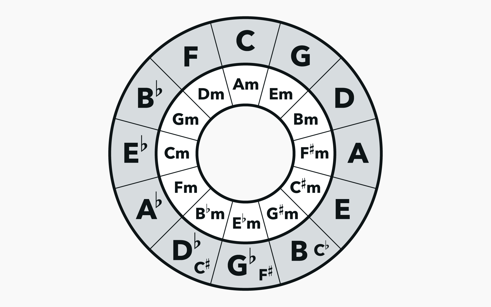

# Accordion Chord Master 🪗

A harmonic exploration tool designed for **Ansambels** and **Composers** of diatonic music. This tool is a specialized reference for discovering relative minors, secondary dominants, and harmonic shifts within the **Circle of Fifths**.



## 🎯 The Purpose

In traditional accordion music (such as Slovenian *Narodnozabavna*), composers often look for ways to add depth to their arrangements. This tool helps musicians visualize and hear how they can:

* **Switch Modes**: Instantly find the relative minor for a specific major key to create "darker" bridge sections or transitions.
* **Harmonic Substitutions**: Explore chords that correlate to the primary major tonic based on their position in the quintal circle.
* **Transposition Testing**: Quickly swap between different accordion tunings (*Uglasitve*) to see how a chord progression feels in different registers.

## ✨ Features for Composers

* **Harmonic Mapping**: Buttons are organized by musical role (Tonic, Dominant, Subdominant) to help visualize the relationship between keys.
* **Relative Minor Discovery**: Identify and test the minor chords that naturally correlate to your primary major keys.
* **Tone.js Sampler Engine**: High-fidelity acoustic piano samples with "infinite hold" (looping) logic, allowing composers to hear how specific chord voicings sustain.
* **Octave Layering**: Toggle the **High** switch to test how higher chord inversions interact with your ensemble's arrangement.

## 🛠️ Technical Details

* **Audio Engine**: [Tone.js](https://tonejs.github.io/) (Web Audio API).
* **Sample Optimization**: Uses a 7-anchor sample system (A0, G1, F#2, C4, C5, C6, C8) to provide a full 88-key range with minimal loading times.
* **Chord Logic**: Dynamically builds Major and Minor triads with precise semitone intervals.

## 🚀 How to Use for Arrangement

1.  **Select Tuning**: Choose the base tuning of your accordion (e.g., C-F-Bb, B-Es-As, etc.).
2.  **Find Your Key**: Locate your Tonic (*Tonika*) button.
3.  **Explore Substitutes**: Use the parallel minor rows to find "borrowed" chords that fit your melody.
4.  **Test Voicings**: Toggle the **High** switch to see if a higher register fits better in your ensemble's mix.

## 🎹 Setup & Requirements

### Required Audio Files
The engine expects an optimized list of anchor files in `/static/samples/`:
`1.mp3`, `12.mp3`, `24.mp3`, `40.mp3`, `52.mp3`, `64.mp3`, and `88.mp3`.

### Running Locally
1. Clone the repo: 
   ```bash
   git clone https://github.com/TheRealH0u/Accordion-Chord-Master.git && cd Accordion-Chord-Master
2. Install requirements:
   ```bash
   pip3 install -r requirements.txt
3. Uncomment this part of the code:
   ```python
   # ! LOCAL RUN ONLY
   # if __name__ == '__main__':
   #    app.run(debug=True, port=5000)
4. Run the app:
   ```bash
   python3 app.py
5. Go to http://127.0.0.1:5000/